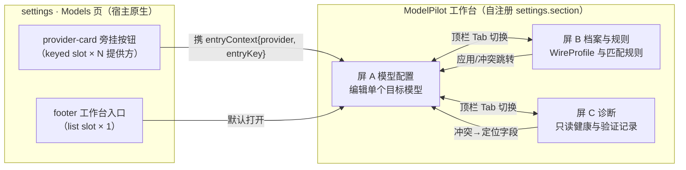
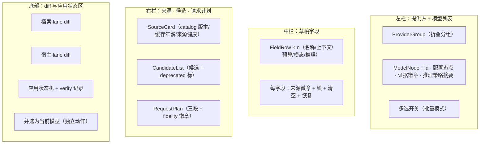
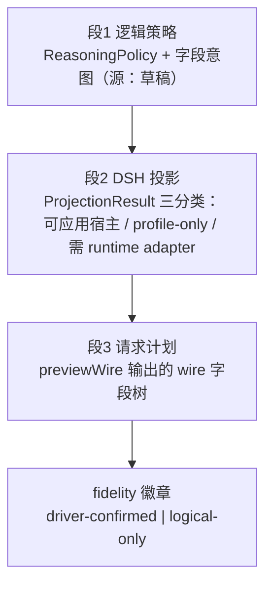
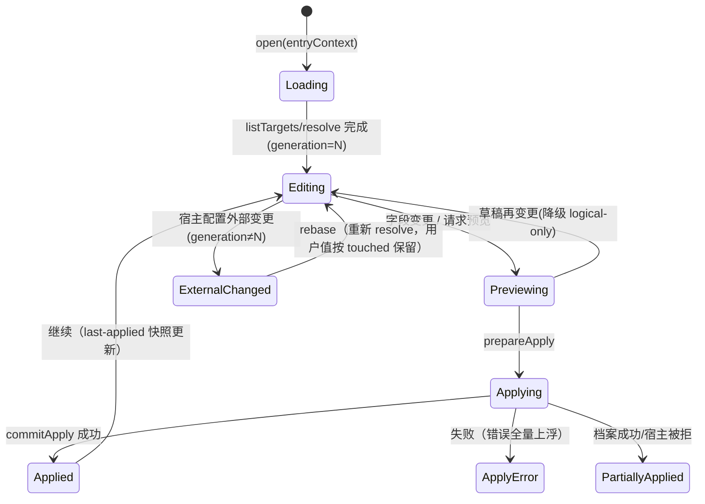

# B4 — 界面与交互设计（ModelPilot）

状态：设计草案 v1（供 B1／B2／B5 交叉评审）
日期：2026-11-10
范围：**纯设计文档**——信息架构 + 组件职责 + 状态流。不含 CSS 级细节（视觉规范另行产出）。
证据标签沿用 dsh-compat-audit 体系：`[已核对-源码]` `[已执行-探针]` `[设计定案]` `[推断-待验证]` `[待验证-P2]`。
上游消费：B1 的 Remote 接口（`modelAssistant.*`）、B2 的数据模型（CapabilitySnapshot／StoredField 三态／ReasoningPolicy／WireProfile／ProjectionResult 三分类）。B1／B2 尚未定稿之处按「对齐引用」书写，B4 不自定义它们的内部结构；两者终稿若与本稿有出入，以终稿为准、B4 的相应字段名跟随调整。

---

## 0. 事实基线引用（本设计的输入面）

| # | 事实 | 证据 |
| --- | --- | --- |
| F1 | 挂载点在两版中逐字稳定：`settings.models.provider-card`（带键插槽，载荷 `{provider, configured, keyConfigured}`，第二参 `{entryKey}`）= 提供方卡片内旁挂的入口按钮；`settings.models.footer`（列表插槽，载荷 `{}`）= 页脚的完整入口 | `[已核对-源码]`（01-gap-fill U2：dsh-client-ui-slots 两版逐字节相同；settings-models 消费端两版同构） |
| F2 | settings 区块的注册形态：`ctx.slots.inject("settings.section", () => ctx.slots.register({name:"settings.section", id, order, label, inject, children}))`（与 settings-models 自身注册的方式相同） | `[已核对-源码]` |
| F3 | 客户端插件形态：`package.json dsh.client = { inject: ["@deepseek-ai/dsh-client-ui-settings", "@deepseek-ai/dsh-client-locale", ...], platform: "web" }`；React 跟随宿主（0.2.1 = react 19 + react-jsx-runtime）；闭包内的 React 组件形态（参照 dsh-plugin-model-capability 的 `lib/client.js`） | `[已核对-源码]` |
| F4 | 宿主原生的 0.2.1 已经有 ModelReasoningEfforts 编辑（off／`low`／`medium`／`high` + 线上值）；0.2.0 没有。插件推理面板的定位 = 跨模型批量管理 + 来源置信展示 + 预设档案，**不是去补原生的缺失** | `[已核对-源码]`（0.2.1 的 client-ui-settings-models） |
| F5 | maxTokens 的三值展示义务：来源声明的输出能力／用户希望的请求预算／宿主当前的绑定值（宿主会把条目的 maxTokens 物化为缺省请求预算，两版一致） | `[已核对-源码]` |
| F6 | 预览分两级：驱动确认级（经宿主 `resolveCallConfig`／`prepareCall(configure)` 实际校验）与逻辑级（仅由协议模板推导）。语义：`requestSucceeded ≠ controlAcknowledged` | `[设计定案]`（B1 对齐引用） |
| F7 | deepseek 的投影白名单 `{name?, contextWindow?, maxTokens?, inputModalities?}` + 路由级 `reasoningEffort?` 四值枚举（off／`low`／`high`／max）；`reasoningEfforts` 字典输入 deepseek 投影必须报不支持，禁止静默映射 | `[已核对-源码]`（01-gap-fill U4，两版同构） |
| F8 | models.dev 的字段面：`limit.context/output`、`modalities.input/output`、`reasoning_options: [{type:"toggle"}|{type:"effort",values}|{type:"budget_tokens",min,max}]`、`status:"deprecated"` 等；缓存 `dshCachePath("modelpilot","models-dev-v1.json")`，TTL 24 小时 + 最后可用快照 | `[已执行-探针]`（01-gap-fill U6） |
| F9 | 语言包模式：`ctx.locale.register(ns, {zh, en})` + `ctx.locale.bind(ns)`，组件内用 `t()` 取词（与 settings-models 同款） | `[已核对-源码]` |
| F10 | selectModel 纪律：普通保存**不调用**；显式「并选为当前模型」是独立动作，并披露默认同步的副作用 | `[设计定案]`（任务书给定） |

---

## 1. 信息架构总图

### 1.1 层级与入口

- **工作台的宿主位置**：按 F2 的形态注册独立的 `settings.section`（`id: "modelpilot.workbench"`，`order` 排在 settings-models 之后，`label` 走语言包），`inject` 返回工作台外壳（三屏的标签容器）。入口按钮不承载编辑界面，只负责**导航 + 携带上下文**。
- **深链上下文**：点 provider-card 按钮 → `WorkbenchStore.open({ provider, entryKey })` → 工作台打开屏 A 并预选中该提供方下唯一／推荐的模型；多模型时左侧列表展开并高亮该提供方分组。若宿主不支持跨区块的导航定位（OQ-1），按 §9 的保守降级处理。
- **每一屏的职责一句话**：
 - **屏 A 模型配置**：围绕单个目标模型，做字段编辑、来源与候选查看、投影预览与应用。
 - **屏 B 档案与规则**：WireProfile 档案库与匹配规则（精确／路由／协议／全局）的管理与导入导出。
 - **屏 C 诊断**：只读视图——目录健康、匹配链、冲突、驱动能力矩阵、应用台账与验证记录。

### 1.2 导航关系规则

| 关系 | 行为 |
| --- | --- |
| 入口 → 工作台 | 两个入口共享同一个 `WorkbenchStore.open(entryContext)`；同一个 DraftStore 单例（§6.3） |
| 工作台内部 | 顶栏标签（A／B／C），切换不丢弃草稿（脏稿留在内存，只有切换目标才触发确认弹窗） |
| B → A | 档案的「应用到目标」动作会生成待处理差异，携带 targetKey 跳到屏 A 的预览区 |
| C → A | 冲突／未支持字段条目的「定位」按钮跳到屏 A，并滚动到对应字段行 |

**证据**：F1／F2／F3 为 `[已核对-源码]`；工作台作为独立区块与深链上下文属 `[设计定案]`；跨区块导航定位能力属 `[推断-待验证]`（OQ-1）。

---

## 2. 屏 A — 模型配置工作台

### 2.1 三栏布局与组件职责

| 区域 | 组件职责 |
| --- | --- |
| 左栏 ProviderGroup／ModelNode | 消费 `modelAssistant.listTargets`；节点渲染配置状态（configured／keyConfigured 缺失警示）以及每个目标推理策略的一句话摘要；多选进入批量模式（R6 批量管理的入口） |
| 中栏 FieldRow（每个可编辑字段一行） | 行内包含：字段标签、输入控件、**来源徽章**、**锁**、**清空**、**恢复** 四个操作 |
| 右栏 SourceCard／CandidateList／RequestPlan | 只读；RequestPlan 是两级预览语义的展示主体（§2.4） |
| 底部差异区 | 应用前的最后确认面；档案与宿主**分项**展示（§2.5） |

### 2.2 中栏的字段规格（逐字段）

统一的行内操作语义（所有字段一致）：

| 操作 | 行为 | 禁用条件 |
| --- | --- | --- |
| 来源徽章 | 显示该字段当前值的三态来源：`继承`（未设置，按宿主／模板默认）／`用户`（草稿显式设置）／`宿主`（宿主物化后的只读显示）——对应 B2 的 StoredField 三态，显示映射以 B2 终稿的枚举为准 | — |
| 锁（lock） | 字段被规则／档案／宿主绑定占用时呈锁定态；悬停提示说明占用者（例如「路由规则 profile:long-output」）。锁定字段可以查看、可以临时解锁（解锁 = 本草稿临时覆盖，应用时按优先级裁决并在差异中标注） | 没有占用者 |
| 清空（clear） | 回退到继承态（值移除，StoredField 回到「未设置」） | 已经是继承态 |
| 恢复（restore） | 恢复用户最近一次已应用的值（DraftStore 保留了上次应用的快照） | 没有历史值 |

逐字段规格：

| 字段 | 控件 | 来源／候选联动 | 投影约束（界面呈现） |
| --- | --- | --- | --- |
| **name** | 文本输入 | 目录的 `name` 作为占位符 | 层级很浅：仅展示，占位提示「目录声明：xxx」 |
| **工作上下文 contextWindow** | 数字输入 + 语义切换（combined／input，仅当目录提供语义信息时才显示切换；没有信息就标注「语义未知」） | 目录的 `limit.context`（U6 映射）作为参考值徽章；目录值与草稿值不等时行内提示 | 是否可投影由驱动白名单决定；不可投影时显示徽章「仅档案」 |
| **输出预算 maxTokens** | **三值展示组件**（§2.3） | 目录的 `limit.output` | 同上 |
| **输入模态 inputModalities** | 复选框组：text／image + 其他目录声明的模态 | 目录的 `modalities.input`；pi-ai 只认 text／image，**额外模态以禁用复选框呈现**并提示「目录已声明，当前投影不支持」 | 白名单外的值不进宿主投影，可以存档案 |
| **推理面板 R6** | 独立面板（§3） | 目录的 `reasoning_options` | 见 §3 |

### 2.3 三值展示组件（maxTokens 的义务）

组件 `ThreeValueBudget`，一行三列：

| 列 | 数据 | 展示 |
| --- | --- | --- |
| ① 来源声明的输出能力 | 目录的 `limit.output`（U6 → `Evidence.outputLimit`，declared） | 静态徽章「目录：262144」 |
| ② 用户希望的请求预算 | 草稿的 StoredField | 输入框（唯一可编辑的位置） |
| ③ 宿主当前的绑定值 | 宿主配置物化后的值（两版一致：条目 maxTokens = 缺省请求预算） | 静态徽章「宿主：256000」 |

行为规则：
- ② 为空时显示 ③，并标注「未显式设置，按宿主绑定值发送」。
- ② > ① 时行内告警（不阻塞，用户可以声明覆盖）——目录声明是**能力参考**，不是硬闸。
- ③ 与 ② 不一致且用户没改过（untouched）时，提示「宿主绑定值与草稿不同，应用后以 ② 为准」。
- 任一值缺失时显示 `—`，不显示 0。

### 2.4 右栏 RequestPlan：三段式 + 保真度徽章

- **段 2 的分档着色**：可应用宿主（绿）／仅档案（蓝）／需运行时适配器（灰，P3 之前置灰并标注「P3 通道，当前仅存档案」——对应 U5 的 `agent/request` 瀑布流通道预留）。
- **保真度徽章的语义**：
 - `driver-confirmed`：在本代次内，该计划已经过 `resolveCallConfig`／`prepareCall(configure)` 的实际校验通过；草稿任一字段再改动即**降级回 logical-only**（代次失效，§6.1）。
 - `logical-only`：仅由协议模板推导。界面文案固定为「推导的计划，未经驱动确认」，**禁止**表述成「将发送」。
- 段 3 的线上字段树逐字段可折叠；`reasoningEfforts` 字典 → deepseek 这类不支持的条目，在段 2 以红色条目列出（F7，禁止静默映射的界面落点）。

### 2.5 底部差异区与应用状态区

**分项通道（档案／宿主分开，不合并展示）**：

| 通道 | 内容 | 动作 |
| --- | --- | --- |
| 档案通道 | 本草稿将写入 WireProfile 的字段差异（相对当前生效的档案） | 单独勾选应用 |
| 宿主通道 | 将写入宿主配置的投影结果差异（仅 `ProjectionResult` 的「可应用宿主」部分） | 单独勾选应用 |
| 适配器通道（只读置灰） | 「需运行时适配器」的字段——首版不落地，展示为待 P3 | 不可勾选，悬停提示说明 |

**应用状态机**：`clean → dirty → preview-stale → applying → applied / apply-error / partially-applied`（档案已写、宿主被拒时进入 partially-applied，底部两条通道各自显示结果，`commitApply` 的结果回填）。

**「并选为当前模型」**：与「应用」**分离**的独立按钮（F10）。点击先弹披露：「将把 {model} 设为当前模型，影响后续代理请求的默认路由与默认同步行为」。普通保存路径**不出现**任何 selectModel 调用。

**证据**：F1／F3／F5／F7／F10 为 `[已核对-源码]` `[设计定案]`；U6 的 models.dev 字段为 `[已执行-探针]`；U5 的适配器通道为 `[设计定案]`（运行时 `[待验证-P3]`）。

---

## 3. R6 推理面板设计

### 3.1 定位声明（重复一次以约束实现）

原生 0.2.1 已有单模型的 ModelReasoningEfforts 编辑（F4）。本面板是**跨模型批量管理 + 来源置信展示 + 预设档案**的界面，不与原生单模型编辑器比拼单点能力；0.2.0 的用户由此获得能力，0.2.1 的用户由此获得批量与置信。

### 3.2 四区规格

| 区 | 选项 | 说明文案（核心句） | 来源标注 |
| --- | --- | --- | --- |
| ① 继承 | 单选「继承（不写控制字段）」 | 「按当前驱动处理，不保证线上无控制字段」——插件侧不写入任何推理控制字段，驱动自身的行为不在插件承诺范围 | 有驱动确认级观测时附上「上次验证观测：请求携带／未携带 <参数>」 |
| ② 关闭 | 单选「关闭」 | 显式禁用推理；线上表现依驱动而定，见 §3.3 的子面板 | 关闭参数是否存在 = 驱动能力矩阵的数据 |
| ③ 档位（`effort`） | 单选组：目录声明的档位／用户模板的档位／自定义线上值（输入框） | 每个档位旁标来源徽章：`目录`（目录的 `reasoning_options.effort.values`，U6）／`模板`（用户预设）／`自定义`。**跨档位系禁止静默映射**：pi-ai 的七档字典输入 deepseek 目标时，界面直接显示红色的不支持条目（F7），并给出「该目标只接受四值枚举」的修正建议（off／`low`／`high`／max） | 自定义值仅在驱动接受自由线上值时才可用（0.2.1 原生的「+ 线上值」是同一语义）；可用性由驱动能力矩阵驱动 |
| ④ 预算（`budget`） | 数字输入（min／max 来自目录 `budget_tokens` 的声明时做钳制） | 固定徽章「**仅存档案**（首版无宿主承接）」——写入 WireProfile，不进宿主投影 | 目录的 `reasoning_options{type:"budget_tokens"}` 提供范围时显示 min／max |

- 面板顶部展示**当前驱动**的名称与「驱动能力速览」（允许的推理字段列表，数据是屏 C 矩阵行的切片）。
- **批量模式**（左栏多选触发）：四区变为矩阵视图——行 = 选中的目标，列 = 四区的当前值；单个单元格可改，顶部「应用到全部选中」批量改档；任一目标出现不支持时该格红显，且不阻塞其他目标。

### 3.3 「实际发送参数预览」子面板

固定在四区下方，实时计算（推理策略、目标驱动、驱动能力矩阵）：

| 输入组合 | 展示 |
| --- | --- |
| off 且线上语义为 `null`（驱动没有独立的关闭参数） | 「**不发参数**」（附一句：该驱动通过省略字段来表达关闭） |
| off 且线上语义为 `off:"reasoning_effort"`（驱动需要显式参数来表达关闭） | JSON 片段视图，例如 `{ "reasoning_effort": null }`（以 B1 的 previewWire 实际输出为准，界面不自行拼线上结构） |
| 档位档位 | 对应的 JSON 片段 `{ "reasoning_effort": "<档位>" }` |
| 预算 | 「仅存档案，不出现在请求计划中」+ 档案值回显 |
| 继承 | 「插件不写入；驱动行为未验证时显示 logical-only 水印」 |

- 子面板整体挂当前的保真度徽章（§2.4 同语义、同失效规则）；logical-only 时 JSON 片段右上角打「推导」水印。
- 子面板的数据唯一来源是 B1 的 `previewWire`；界面不做本地协议拼装，避免两份实现漂移。

**证据**：F4／F7 为 `[已核对-源码]`；U6 的 reasoning_options 三型为 `[已执行-探针]`；previewWire 作为单一数据源与子面板行为属 `[设计定案]`。

---

## 4. 屏 B — 档案与规则

### 4.1 档案列表

- 按 WireProfile 的作用域分四组展示：**连接／路由／协议／ID**；组内条目显示：名称、作用键、字段数、schema 版本、最后修改时间。
- 条目操作：查看（只读差异视图）、编辑（进入规则编辑器的上下文）、复制、删除（二次确认，并显示引用该档案的规则数）。
- 作用域分组头部显示命中统计（来自屏 C 匹配链数据的聚合），帮助用户判断「这个档案到底覆盖了多少目标」。

### 4.2 规则编辑器

| 规则类型 | 匹配键 | 界面要点 |
| --- | --- | --- |
| 精确 | 精确的模型 id | 单值输入 + 目录 id 补全 |
| 路由 | 提供方／端点路由 | 提供方选择器 |
| 协议 | 协议族 | 协议枚举选择 |
| 全局 | 全局缺省 | 兜底规则，置于优先级链末位（可查看，但不能拖出末位） |

- **优先级展示**：规则按优先级排成纵向链（精确 > 路由 > 协议 > 全局），支持上移／下移调整；每个规则节点显示「命中范围预览」（该规则当前会命中哪些已列出的目标——复用屏 C 的匹配链计算结果）。
- 循环／冲突检测：规则保存前经 B1 校验；冲突在编辑器内即时红显（复用 `ProjectionResult` 的冲突项），不等到屏 C 才暴露。

### 4.3 预设管理

- 内置预设（首版至少：「关闭推理」「默认档位」「长输出高预算」）+ 用户自建的预设。
- 预设 = 参数化的 WireProfile 模板；「应用到目标」会生成待应用的差异并跳到屏 A 预览（不在屏 B 内直接写宿主）。

### 4.4 导入导出

| 环节 | 行为 |
| --- | --- |
| 导出 | 带 schema 版本的信封（`schemaVersion` + 档案 + 规则 + 优先级）；**强制去凭据**（key／token 类字段剔除，并在导出摘要中列明剔除了哪些字段） |
| 导入 | 三步强制流程：**选择文件 → 预览差异（新增／覆盖／冲突分类逐条列出）→ 应用**；schema 版本不匹配则走迁移提示或拒绝（版本高于当前 → 拒绝并提示升级）；应用后进入与手动编辑相同的应用状态机 |

**证据**：WireProfile／规则／优先级的结构属 `[设计定案]`（对齐引用 B2）；去凭据与预览后应用属 `[设计定案]`；命中统计复用屏 C 的数据属 `[设计定案]`。

---

## 5. 屏 C — 诊断

只读屏，全部数据来自 B1／B2 已有的能力，不做二次计算：

| 区块 | 内容 | 数据源 |
| --- | --- | --- |
| **目录健康** | 每个来源一行：宿主原生目录／models.dev（版本、缓存年龄、TTL 状态、是否走了最后可用快照兜底） | B2 的 CapabilitySnapshot + U6 的缓存元数据 |
| **匹配路径** | 选中目标 → 五级链逐级展示，高亮**命中的那一级**：① 精确 id 命中 → ② 规范化／别名（`canonical_model_id` 或别名表）→ ③ 路由（同一提供方／端点内唯一）→ ④ 协议（协议族模板）→ ⑤ 全局；未命中 = 无。每一级显示「该级的参与者与落选原因」 | B2 的匹配链结果（链级命名待与 B2 终稿对齐） |
| **冲突列表** | `ProjectionResult` 的冲突项：涉及字段、冲突双方（规则对规则／规则对宿主）、裁决建议；「定位」跳到屏 A 的对应字段 | B2 |
| **驱动能力矩阵** | 行 = 字段（name／contextWindow／maxTokens／inputModalities／reasoningEffort 四值／reasoningEfforts 字典／预算…），列 = 驱动（dsh-llm-deepseek、宿主的 pi-ai 驱动、…），格 = 允许／仅路由级／报不支持（F7 的实例落格：deepseek × reasoningEfforts 字典 = 不支持） | U4 + B2 |
| **投影未支持的字段** | 当前选中目标在投影时被丢弃／拒绝的字段清单，每条注明原因（档位系不同／白名单外／无宿主承接） | B2 的 `ProjectionResult` |
| **最近应用结果（台账视图）** | 按时间倒序：时间、目标、动作（apply／verify）、通道（settings 写路径／agent/request[P3]）、结果 | B1 的台账（含 U5 的 `via=agent/request` 标记位） |
| **验证记录** | 表格两列分立：`requestSucceeded` / `controlAcknowledged`——**分列是硬性要求**，两者语义不同（请求成功 ≠ 控制字段被驱动确认生效），合并即误导 | B1 的 `verifySelected` |

**证据**：U4／F7 为 `[已核对-源码]`；U6 的缓存与字段为 `[已执行-探针]`；五级链命名为 `[设计定案]`（待与 B2 对齐）；`requestSucceeded ≠ controlAcknowledged` 分列属 `[设计定案]`（对齐引用 B1）。

---

## 6. 状态流

### 6.1 DraftStore

| 概念 | 定义 |
| --- | --- |
| **`generation`（代次）** | 单调递增的计数器；打开目标时取值，宿主配置发生外部变更或重基线之后递增；所有预览／验证结果都与代次绑定，代次一变即失效（保真度降级、差异重算） |
| **touched** | 逐字段的布尔值：用户本轮编辑是否改过；重基线时 touched 字段保留用户的值、未 touched 的字段吸附新解析结果 |
| **locked** | 逐字段：被规则／档案／宿主绑定占用（§2.2 的锁语义）；锁定不等于只读——「临时解锁」会产生显式覆盖并在差异中标注 |
| **未触碰** | 草稿 == 打开时的解析快照；未触碰时「应用」按钮禁用 |

### 6.2 与 NativeFormBridge 的关系

- **定位**：工作台是**主入口**；NativeFormBridge 是可选增强——当用户停留在原生 Models 页编辑时，把工作台的草稿／应用结果同步进原生表单状态，避免「改了工作台、原生页还是旧值」的割裂。
- **失败降级路径**（必须成立，桥是增强而不是依赖）：
 1. 桥初始化失败／宿主表单状态不可达 → 工作台全部功能照常，只是原生页要在自己刷新后才显示新值；
 2. 降级**不静默**：屏 C 的诊断显示桥状态（active／降级／不可用），降级时工作台顶部出一次性横幅告知「原生页需刷新后可见新值」；
 3. 桥的故障绝不阻塞 apply 路径（写路径与桥解耦，桥只做单向的展示同步）。
- 若宿主未提供稳定的桥 API（OQ-3），保守默认：桥默认关闭，由诊断屏的开关显式启用（§9）。

### 6.3 双入口的状态共享

- 单例 `WorkbenchStore` + 单例 DraftStore，key = `(scope, targetKey, generation)`。
- provider-card 按钮（带键插槽，每个提供方一个实例）与 footer 按钮调用同一个 `open(entryContext)`；从 provider-card 进入时 `entryContext = {provider, entryKey}`（F1 的载荷），工作台据此预选目标；从 footer 进入时 `entryContext = {}`，走默认目标。
- **单草稿原则**：同一时刻只有一个活跃草稿。已有脏稿时再从另一个入口进入 → 顶部提示「当前有未应用修改（目标 X）」，提供「继续编辑／丢弃并切换」的确认；不在后台并存多份草稿（首版简化，避免并发写的竞态）。
- 入口按钮自身无状态（不显示草稿脏标）——脏稿状态只在工作台内呈现，避免插槽按钮与工作台状态的双向同步复杂度（OQ-5 相关的键盘／焦点面也收敛在工作台内）。

### 6.4 应用动作与 selectModel 纪律（复述为硬约束）

- `prepareApply → commitApply` 只写「用户在差异区勾选的那条通道」；档案通道与宿主通道可以分别应用。
- selectModel（并选为当前模型）**只**由独立按钮触发，带披露弹窗（§2.5）；其他所有保存／应用路径在代码层面都不得出现 selectModel 调用。
- `verifySelected` 是应用之后的可选动作，结果写入台账与屏 C 的验证记录（两列分立）。

**证据**：DraftStore 语义属 `[设计定案]`；桥的降级路径属 `[设计定案]`（桥 API 是否存在为 `[推断-待验证]`，OQ-3）；F10 的 selectModel 纪律属 `[设计定案]`（任务书给定）。

---

## 7. 语言包键位草案

命名空间 `modelpilot`，经 `ctx.locale.register("modelpilot", {zh, en})` + `ctx.locale.bind("modelpilot")`（F9 的模式）。前 30 个键：

| # | 键 | zh | en |
| --- | --- | --- | --- |
| 1 | `workbench.title` | 模型工作台 | Model Workbench |
| 2 | `workbench.tab.models` | 模型配置 | Models |
| 3 | `workbench.tab.profiles` | 档案与规则 | Profiles & Rules |
| 4 | `workbench.tab.diagnostics` | 诊断 | Diagnostics |
| 5 | `entry.smartAdd` | 智能添加 | Smart Add |
| 6 | `entry.smartEdit` | 智能编辑 | Smart Edit |
| 7 | `entry.noKey.hint` | 未配置 API Key | API key not configured |
| 8 | `entry.openWorkbench` | 打开模型工作台 | Open Model Workbench |
| 9 | `field.contextWindow` | 工作上下文 | Context window |
| 10 | `field.contextSemantics` | 上下文语义 | Context semantics |
| 11 | `field.maxTokens` | 输出预算 | Output 预算 |
| 12 | `field.maxTokens.declared` | 目录声明输出能力 | Declared output capability |
| 13 | `field.maxTokens.request` | 请求预算 | Request 预算 |
| 14 | `field.maxTokens.hostBound` | 宿主当前绑定值 | Host-bound value |
| 15 | `field.modalities` | 输入模态 | Input modalities |
| 16 | `field.modalities.text` | 文本 | Text |
| 17 | `field.modalities.image` | 图像 | Image |
| 18 | `field.modalities.extra.disabledHint` | 目录声明，当前投影不支持 | Declared by 目录, not projectable |
| 19 | `reasoning.title` | 推理 | Reasoning |
| 20 | `reasoning.inherit` | 继承 | Inherit |
| 21 | `reasoning.inherit.hint` | 按当前驱动处理，不保证线上无控制字段 | Handled by the current driver; wire control fields are not guaranteed absent |
| 22 | `reasoning.off` | 关闭 | Off |
| 23 | `reasoning.effort` | 档位 | Effort |
| 24 | `reasoning.budget` | 预算 | Budget |
| 25 | `reasoning.budget.profileOnly` | 仅存档案（首版无宿主承接） | Profile-only (no host carrier in v1) |
| 26 | `reasoning.preview.title` | 实际发送参数预览 | Actual send preview |
| 27 | `reasoning.preview.none` | 不发送推理参数 | No reasoning parameters sent |
| 28 | `source.declared` | 目录声明 | Catalog |
| 29 | `source.user` | 用户 | User |
| 30 | `source.host` | 宿主 | Host |

后续的键族（只列前缀，随屏 B／C 的细化补全）：`preview.fidelity.driverConfirmed / logicalOnly`、`diff.lane.profile / host / adapter`、`apply.state.*`、`action.selectAsCurrent` + `.disclosure`、`profiles.scope.*`、`rules.type.* / priority`、`importExport.*`、`diag.*`（匹配链五级、矩阵格值、台账列）、`a11y.aria.*`、`bridge.status.*`、`external.changed.banner`、`rebase.*`。

**证据**：F9 的语言包模式为 `[已核对-源码]`；键位划分为 `[设计定案]`。

---

## 8. 无障碍与错误态的最低要求

| 类别 | 最低要求 |
| --- | --- |
| aria-label | 所有纯图标按钮（锁／清空／恢复／折叠箭头）都必须有 `aria-label`（走语言包的 `a11y.aria.*` 键）；来源徽章与保真度徽章一律**文字 + 颜色**双通道，禁止只用颜色表意 |
| 错误不吞 | 三重上浮：字段行内错误（就近）+ 应用区的错误摘要（底部）+ 台账记录（屏 C）。任何被 B1／B2 拒绝的操作都必须有可见反馈；「部分成功」（partially-applied）必须两条通道分别展示结果，禁止笼统地说「失败」 |
| 加载态禁写 | 代次加载中／预览失效重算中／applying 中：输入控件与「应用」按钮一律禁用（防止撕裂式编辑）；禁用必须伴随原因文案（「加载中」「预览重算中」），不允许出现没有解释的灰按钮 |
| 焦点与键盘 | 工作台标签容器的焦点顺序为左→中→右→底部；确认弹窗焦点圈闭 + Esc 关闭 + 关闭后焦点还原到触发元素；插槽注入的按钮作为宿主表单内的元素，遵循宿主的焦点顺序（不自建 tabindex 洞） |
| 表格语义 | 屏 C 的矩阵／台账表格带 `caption` 与表头的 `scope`；验证记录两列分立本身也是语义正确性要求（§5） |

**证据**：本节是界面质量底线 `[设计定案]`；插槽按钮的焦点顺序跟随宿主属 `[推断-待验证]`（OQ-5）。

---

## 9. 开放问题与保守默认

| # | 开放问题 | 保守默认（未决时按此实现） |
| --- | --- | --- |
| OQ-1 | 宿主注册 `settings.section` 之后，能否从另一个区块的插槽按钮深链定位到工作台并携带目标上下文（F2 的注册形态可见，导航能力尚未核证） | 入口按钮打开工作台的默认屏（屏 A）；提供方上下文以顶部横幅呈现「来自 {提供方} 卡片，请选择模型」，列表自动展开并高亮该提供方分组；不做跨区块的路由 hack |
| OQ-2 | footer 列表插槽的条目容器能否承载按钮以外的说明文字（副标题） | 首版 footer 只放单个按钮，没有副标题；说明文字移入按钮的悬停提示 |
| OQ-3 | NativeFormBridge 是否存在宿主稳定的 API（0.2.1 的类型声明里未见稳定面） | 桥整体默认关闭；诊断屏提供显式开关（探测到可用才允许开启）；工作台功能完全不依赖桥 |
| OQ-4 | `verifySelected` 中 `controlAcknowledged` 的判定信号来源与形态（B1 依赖） | 界面只忠实渲染 B1 返回的两列布尔，不自行推断；B1 未返回该字段之前，第二列显示「未验证」而不是 false |
| OQ-5 | 插槽注入按钮的键盘焦点顺序是否完全由宿主管理、会不会被原生表单校验拦截提交 | 按钮用 `<button type="button">`（不参与表单提交），不自定义 tabindex；异常表现记录到屏 C 的桥／环境状态区 |
| OQ-6 | 工作台区块的 `order` 在两版宿主里的排序稳定性 | order 取 settings-models 之后的保守大偏移；排序异常不阻塞功能（只影响入口顺序的观感） |

**保守默认汇总**：① 工作台 = 独立的 `settings.section`，入口只负责导航、不承载界面；② 一切预览未达到驱动确认级，一律 logical-only 徽章 + 「推导」水印，文案禁用「将发送」；③ 桥与深链都是增强，失效即降级且降级可见（横幅／诊断态），主功能零依赖；④ 两列验证分立、档案／宿主通道分项、双入口共享单草稿——这三条结构性约束在 OQ 全部未决时也成立。

---

*（B4 完。后续：B5 需消费 §2.4 的预览失效与 §6.1 的状态机；B2 终稿落定后回填 §2.2 的三态枚举名与 §5 的五级链命名。）*